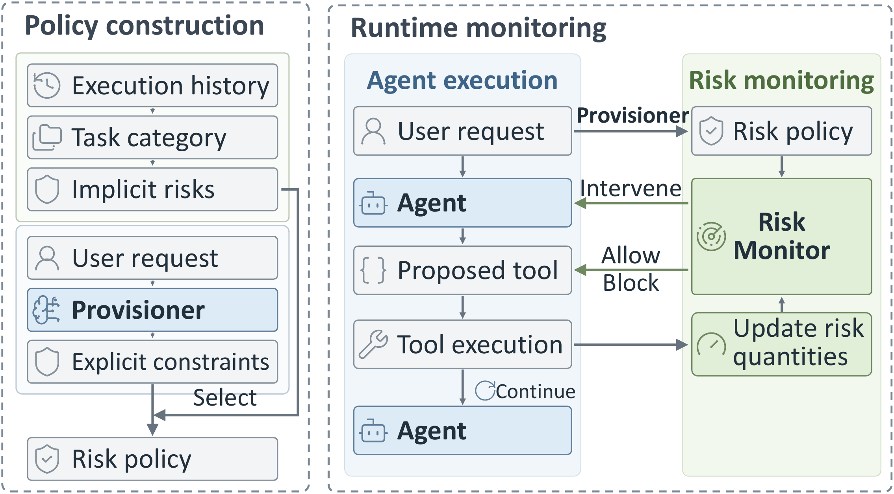

# RATION: Towards Quantitative Risk-Based Access Control for AI Agents

Yuntao Du<sup>1,2</sup>, Harsh Chaudhari<sup>1</sup>, Yuetian Chen<sup>1,2</sup>, Ron Heichman<sup>1</sup>, Ashish Jayamohan<sup>1</sup>, Kumar Pallav<sup>1</sup>, Mahim Patel<sup>1</sup>, Kaiyuan Zhang<sup>1,3</sup>, Kyle Polley<sup>1</sup>, Jerry Ma<sup>1</sup>, Ninghui Li<sup>1,2</sup>

<sup>1</sup>Perplexity, <sup>2</sup>Purdue University, and <sup>3</sup>Rutgers University

> [!WARNING]
> This is a research artifact released to reproduce the results in our paper. This is **not** a Perplexity product, and we are not planning to provide support for and/or maintain this codebase.

RATION protects tool-using AI agents against indirect prompt injection (IPI). Instead of restricting
individual actions, it regulates the measurable risks that accumulate during task execution.

<p align="center">
  
</p>

1. **Policy construction.** RATION constructs an implicit risk policy for each task category from
   historical executions: a tool allow-list and behavioral thresholds. When a user request arrives,
   an LLM-based Provisioner identifies its task category, selects the corresponding implicit risk
   policy, and extracts explicit constraints from the request, such as an email recipient or a
   spending limit. Together, they form the task-specific risk policy.
2. **Runtime monitoring.** A deterministic Risk Monitor evaluates each proposed tool call against
   the task-specific risk policy and the accumulated risk quantities. It allows the call, blocks it,
   or holds it and prompts the agent to reconsider.

This repository contains the RATION implementation, the risk policies used in the paper, and the
harnesses for the four benchmarks: DTap, AgentDyn, AgentDojo and ASB.

## Quick start

The example runs the Provisioner and the Risk Monitor on an AgentDyn payment task with a scripted
LLM, without network access. It shows an allowed call, a call outside the tool allow-list, a payment
that violates a value constraint, a call held at a behavioral threshold, and a call blocked by the
user's per-action limit.

```bash
uv venv --python 3.12 .venv
uv pip install --python .venv/bin/python -e ".[agentdojo]"
.venv/bin/python examples/quickstart.py
```

[docs/method.md](docs/method.md) describes the method and how to put RATION in front of another
agent; [docs/policies.md](docs/policies.md) describes the policy files.

## Repository layout

```
ration/                     RATION core: risk policy, Provisioner, Risk Monitor, feedback
adapters/<benchmark>/       RATION in each benchmark harness
  environments/<domain>/    policy.yaml and policies.<model>.json for every domain
  config/                   Provisioner and feedback prompts
baselines/                  the baseline defenses compared in the paper
benchmarks/<benchmark>/     benchmark settings, tool interfaces, folds and task lists
scripts/<benchmark>/        run.sh (setup, run, report) and the benchmark harness
scripts/common/             OpenAI client, local OpenAI-compatible proxy, metrics
reproduced_results/         per-task results of the main comparison
examples/, docs/, tests/
```

## Setup

Requirements: Python 3.12, [uv](https://docs.astral.sh/uv/) and an OpenAI API key. ASB also needs
Python 3.11 (uv downloads it). DTap needs a Linux host with Docker.

```bash
uv venv --python 3.12 .venv
uv pip install --python .venv/bin/python -e ".[agentdojo]"
cp .env.example .env        # then set OPENAI_API_KEY
```

The agent model is GPT-5.4 (`gpt-5.4`) on DTap and GPT-4.1 (`gpt-4.1`) on AgentDyn, AgentDojo and
ASB (`benchmarks/<benchmark>/protocol.json`). The Provisioner uses the same model as the agent.
Every LLM call, including those made by the benchmarks' internal judges and simulators, goes to the
OpenAI API.

## Running RATION

Every benchmark has one controller with three commands: `setup`, `run` and `report`. A run is
resumable: completed tasks are kept, and running the same command again executes only the tasks
that are missing or failed with an API error. Results are written to
`results/<benchmark>/defense/ration/main_results/run1/<domain>/`.

### DTap

```bash
scripts/dtap/run.sh setup travel
scripts/dtap/run.sh run ration travel
scripts/dtap/run.sh report ration
```

`setup` and `run` take one domain. The report needs all 14 domains: `travel telecom research code
medical browser os-filesystem customer-service finance crm legal workflow windows macos`. The
`windows` and `macos` domains run virtual machines and need `/dev/kvm`. Download their images after
`setup` with `hf download AI-Secure/decodingtrust-windows-qcow2 --repo-type dataset --local-dir
vendor/dtap/dt_arena/envs/windows/windows` and `hf download AI-Secure/decodingtrust-macos-qcow2
--repo-type dataset --local-dir vendor/dtap/dt_arena/envs/macos/macos`.

`run` starts a local OpenAI-compatible proxy on port 8903 that forwards every request to the OpenAI
API with your `OPENAI_API_KEY`. The `openrouter.ai/v1` segment in its URL is only a path the proxy
accepts; no request goes to OpenRouter. The proxy has no authentication and listens on all
interfaces (`0.0.0.0`) so that the `medical` environment's Docker container can reach it. Run DTap
on a trusted network or behind a firewall, or set `PROXY_HOST=127.0.0.1` when you do not run
`medical`.

### AgentDyn

```bash
scripts/agentdyn/run.sh setup
scripts/agentdyn/run.sh run ration
scripts/agentdyn/run.sh report ration
```

### AgentDojo

```bash
scripts/agentdojo/run.sh run ration
scripts/agentdojo/run.sh report ration
```

### ASB

```bash
scripts/asb/run.sh setup
scripts/asb/run.sh run ration
scripts/asb/run.sh report ration
```

## Reproduce the results

`reproduced_results/` contains the per-task results of the main comparison in the paper. The main
table and the per-domain metrics can be recomputed from these files with the Python standard
library only:

```bash
python3 scripts/reproduce_results.py
python3 -m scripts.agentdojo.report --source reproduced --run-key run1 --condition ration
```

The metrics are Attack Success Rate (ASR), Utility Under Attack (UA) and Benign Utility (BU), in
percent with 95% confidence intervals. `--source results` reads a fresh run instead. AgentDyn and
AgentDojo average their domains equally, and ASB pools its 400 attacked executions. DTap averages
its 14 domains equally; within the eight domains that partition tasks into categories, it averages
the categories. Confidence intervals propagate the binomial variance through the same weights.

Run the tests with `.venv/bin/python -m unittest discover -s tests`.

## Acknowledgements

Benchmarks: [DTap](https://github.com/AI-secure/DecodingTrust-Agent),
[AgentDyn](https://github.com/SaFo-Lab/AgentDyn), [AgentDojo](https://github.com/ethz-spylab/agentdojo)
and [ASB](https://github.com/agiresearch/ASB). The baselines build on the released code of
[CaMeL](https://github.com/google-research/camel-prompt-injection), [DRIFT](https://github.com/SaFo-Lab/DRIFT),
[Progent](https://github.com/sunblaze-ucb/progent), [AttriGuard](https://doi.org/10.5281/zenodo.20308739),
[MELON](https://github.com/kaijiezhu11/MELON), [DataSentinel](https://github.com/liu00222/Open-Prompt-Injection),
[Prompt Guard 2](https://huggingface.co/meta-llama/Llama-Prompt-Guard-2-86M),
[PI Detector](https://huggingface.co/protectai/deberta-v3-base-prompt-injection-v2) and AgentDojo's
built-in defenses.

## License

RATION is released under the [MIT License](LICENSE). Some code, prompts and data come from other
projects and keep their original licenses; see [THIRD_PARTY_NOTICES.md](THIRD_PARTY_NOTICES.md).

## Citation

```bibtex
@misc{du2026ration,
  title         = {{RATION}: Towards Quantitative Risk-Based Access Control for {AI} Agents},
  author        = {Du, Yuntao and Chaudhari, Harsh and Chen, Yuetian and Heichman, Ron and Jayamohan, Ashish and Pallav, Kumar and Patel, Mahim and Zhang, Kaiyuan and Polley, Kyle and Ma, Jerry and Li, Ninghui},
  year          = {2026},
  eprint        = {2610.24311},
  archivePrefix = {arXiv},
  primaryClass  = {cs.CR},
  url           = {https://arxiv.org/abs/2610.24311}
}
```
