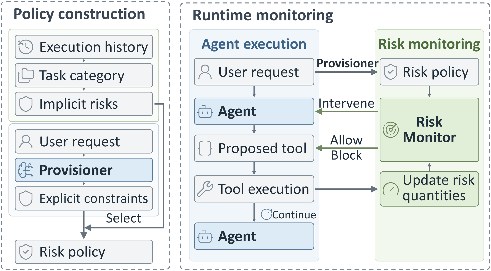

# Method

RATION is a security framework that realizes Quantitative Risk-Based Access Control (QRBAC) for AI
agents. It tracks measurable risks associated with agent actions and enforces quantitative
constraints throughout task execution, instead of restricting each action in isolation.

<p align="center">
  
</p>

## Threat model

The user request and the agent's configuration (system messages and tool descriptions) are trusted.
External observations, such as webpages, files and tool outputs, may contain untrusted or
adversarial content. *Task execution* is the complete sequence of agent interactions from receiving
the user request until the task is completed or terminated.

## Risk policy

RATION regulates the agent through a task-specific risk policy, which consists of rules over the
agent's tool calls. The policy combines explicit constraints from the user request with the implicit
risk policy of the request's task category.

| Source | Policy rule | What it constrains | Cumulative | Example |
|---|---|---|---|---|
| Explicit | Value constraint | Values an argument may take | No | Send to `alice@corp.com` |
| Explicit | Per-action limit | Quantity in a single action | No | At most $200 per transfer |
| Explicit | Total limit | Quantity or count across actions | Yes | At most 3 emails sent |
| Implicit | Tool allow-list | Tools that may be invoked | No | Calendar tools for scheduling |
| Implicit | Behavioral threshold | Counts of calls, write/execute calls, and tokens | Yes | 17k token usage |

**Explicit constraints** capture requirements stated in the user request.

**Implicit risk policy.** Historical user requests are grouped into task categories. For each task
category, the tool allow-list contains all tools observed in its historical executions, and each
behavioral threshold is the 95th percentile of the corresponding quantity across historical benign
executions. A fallback category permits all tools of the domain and adopts the maximum behavioral
thresholds across the other task categories. It is used for requests that do not match any task
category.

The repository ships the constructed risk policies for every benchmark domain; see
[policies.md](policies.md). The evaluation uses five-fold cross-fitting: for each held-out fold, the
task categories and their implicit risk policies are constructed only from the other four folds.
`folds.json` selects the policy that governs each task.

## Policy provisioning

Before task execution begins, the Provisioner (`ration/provisioner.py`) reads only the trusted user
request and makes two LLM calls:

1. **Task category selection.** It selects the task category whose description covers the request,
   or the fallback category. This selects the implicit risk policy that applies to the task.
2. **Explicit constraint extraction.** It extracts the explicit constraints stated in the request
   and grounds each one to the corresponding tool and, when applicable, tool argument.

The result is the task-specific risk policy (`BudgetPlan` in `ration/model.py`): the tool
allow-list, the behavioral thresholds, the explicit limits and the value constraints. Tool outputs
never reach the Provisioner.

## Runtime monitoring and enforcement

The deterministic Risk Monitor (`ration/monitor.py`, `ration/engine.py`) intercepts every proposed
tool call before it reaches the environment. After an allowed call executes, it updates the
accumulated quantities. Token usage is recorded after every model generation.

| Decision | When | Effect |
|---|---|---|
| `allow` | No rule is violated | The call executes; the accumulated quantities are updated |
| `refuse` | The tool is not on the tool allow-list, or an argument violates a value constraint | Hard policy violation: the call is blocked and the agent is informed of the violated rule |
| `soft_breach` | A behavioral threshold is exceeded or would be exceeded by the call | The call is held and the agent is prompted to reconsider; the threshold is increased to 1.5 times its previous value |
| `hard_stop` | An explicit limit would be exceeded | Hard policy violation: the call is blocked and the task execution ends |

The agent receives every decision as a tool result prefixed with `[RATION]`. The message templates
are in `adapters/<benchmark>/config/feedback.yaml`.

## Using RATION in another agent

`examples/quickstart.py` runs the complete flow offline with a scripted LLM:

```bash
.venv/bin/python examples/quickstart.py
```

An integration needs five steps:

1. Write a policy table for the agent's tools and task categories ([policies.md](policies.md)) and
   set `RATION_TABLE` to its path, so that the feedback templates can be found.
2. Load it: `domain = load_domain(table).with_policy(policies.for_fold(policies.load(path), fold))`.
3. Provision once per task: `plan = Provisioner(client).plan(user_request, domain).plan`, where
   `client.complete(system=..., user=...)` returns the model's text.
4. Create `monitor = Monitor(plan)`. Before each tool call, call `monitor.check_call(tool, args)`.
   Execute the call only on `allow`, and then call `monitor.commit_success(tool, args)`. Otherwise
   return `decision.message` to the agent as the tool result, and end the task when
   `decision.terminal` is true.
5. After each model call, call `monitor.record_tokens(n)` and handle a returned decision the same way.

The adapters under `adapters/<benchmark>/` show this integration for DTap, AgentDyn, AgentDojo and
ASB.
